# Renderer course formula guide

This chapter starts with the renderer you have, explains each step in plain language, and then derives the math behind it. No graphics or linear algebra background is assumed. You can read it as a walkthrough: follow one model point from the OBJ file to the framebuffer, then revisit each step to see why its formula works. The math applies in any programming language; code references show where the ideas live in this C project.

## Start here: how this program turns a model into lines

The shortest useful summary is: **load points → turn and place them → view them from the camera → flatten them onto the image → draw triangle edges**. The program does not currently fill triangles or resolve which overlapping triangle is closest to the camera.

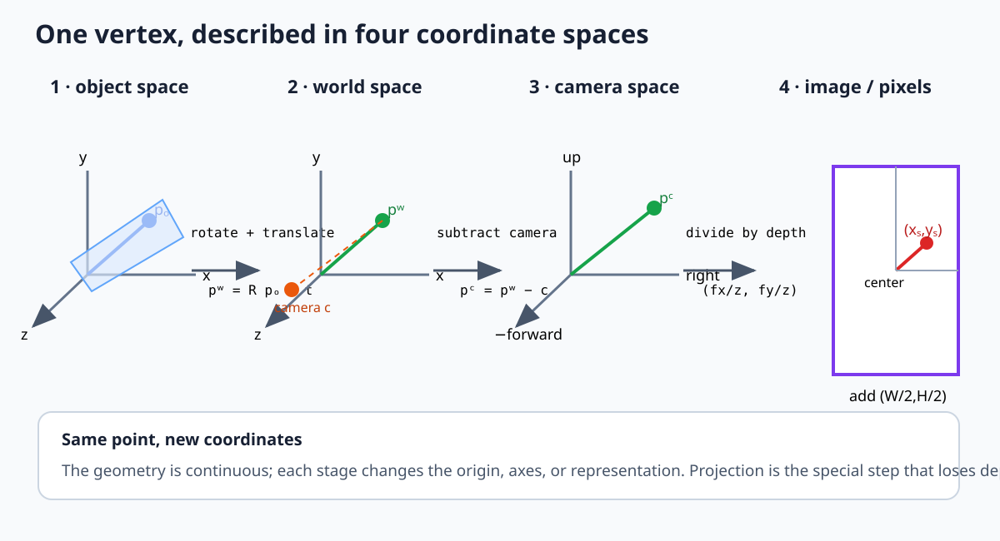

Here is what those words mean in this project:

| Plain meaning | Name used in graphics | Where to find it |
|---|---|---|
| A model's own point, measured from its center | Object-space point | `loadObjFileData`, `normalizeMesh` in `src/mesh.c` and `src/main.c` |
| The point after the model is turned and moved into the scene | World-space point | `update` in `src/main.c` |
| The point measured from the camera | Camera-space point | Subtracting `cameraPosition` in `update` |
| A 2D location on the image | Projected point | `project` in `src/main.c` |
| An integer location in the pixel grid | Pixel coordinate | `drawTriangle`, `drawLine`, `setPixel` in `src/display.c` |

“Space” here just means **which origin and axes were used to write down the coordinates**. Imagine measuring a chair from the corner of its room, then measuring it from your own position. The chair did not teleport; only the measuring reference changed. The same idea applies to an OBJ vertex, the scene, and the camera.

### Follow the actual code, in order

The main loop in `src/main.c` calls `update()` and then `render()`. `update()` prepares triangle corners; `render()` draws them. Inside `update()`, each vertex goes through these steps:

1. `current->vertices[...]` gets the point loaded from the model. `normalizeMesh()` has centered and uniformly scaled the loaded model first.
2. `vect3RotateX`, then `vect3RotateY`, then `vect3RotateZ` turn the point. In the current setup, only X rotation changes: `rotation.x += 0.01f` per update.
3. Adding `current->position` moves this model into the scene. The demo spaces loaded models along X.
4. Subtracting `cameraPosition` measures the point from the camera. The camera starts at `(0, 0, -7)`.
5. `project()` divides X and Y by Z and multiplies by `fov`, which is currently `556`.
6. Adding half the framebuffer width and height moves the projected point from “offset from center” to a pixel location.
7. `drawTriangle()` calls `drawLine()` three times. This draws the triangle outline.

That is the route to keep in mind as you read the rest of the chapter. If a rendered point is in the wrong place, inspect these stages in this order. A mistake in an earlier stage will show up in every later one.

### One point written as the code's equations

Call the loaded model point $p=(x,y,z)$. The symbols $x,y,z$ are just its three coordinates. Let $a$ be the model's current X rotation angle. The X rotation function in `src/vector.c` produces:

\[
p_1=(x,\ y\cos a-z\sin a,\ y\sin a+z\cos a).
\]

Let the model's scene position be $t=(t_x,t_y,t_z)$. The three `+= current->position` statements make the world point:

\[
p_w=p_1+t.
\]

The three `-= cameraPosition` statements then make camera-relative coordinates. Since the camera is `(0,0,-7)`, subtracting it adds 7 to the point's Z coordinate:

\[
p_c=p_w-(0,0,-7)=(p_{w,x},p_{w,y},p_{w,z}+7).
\]

Finally, `project()` and the screen-center additions do this:

\[
x_{pixel}=556\frac{p_{c,x}}{p_{c,z}}+400,\qquad
y_{pixel}=556\frac{p_{c,y}}{p_{c,z}}+300.
\]

The `400` and `300` come from the current 800 by 600 CPU framebuffer: half of its width and height. In code, the corresponding statements are `projectedVertex.x += WINDOW_WIDTH / 2` and the same for Y. The window may be fullscreen, but these framebuffer dimensions are still the values used for this math.

The complete path fits on one line:

\[
\boxed{\text{model point}\;\to\;\text{rotate}\;\to\;\text{add model position}\;\to\;\text{subtract camera}\;\to\;(556x/z,556y/z)\;\to\;+ (400,300)}
\]

The next sections explain why each arrow is reasonable.

## 1. The tiny amount of geometry vocabulary we need

A **point** says “where”: for example, `(2, 1, 5)` means 2 units along X, 1 along Y, and 5 along Z. A **vector** says “which way and how far”: for example, “move 2 units right and 1 unit up.” Both are stored as three numbers in `vect3_t`; the code does not enforce the distinction. We will say which meaning a formula has. The **origin** is the zero point `(0,0,0)`; X, Y, and Z coordinates measure how far a point is from it along each axis.

A 2D coordinate has two numbers, `(x, y)`. A 3D coordinate adds a third, `z`. In this renderer, the camera looks toward increasing Z, so points in front of the camera have positive camera-relative Z. Angles passed to `sinf` and `cosf` are measured in radians. One full turn is $2\pi$ radians; a quarter turn is $\pi/2$ radians. The code adds `0.01` radians to X rotation per update, regardless of frame duration.

When you see a difference like $B-A$, read it as an arrow: start at point A and move until you reach B. When you see a dot product or cross product below, those are ways to compare or combine arrows; each will get a picture and a code connection.

## 2. Vector formulas

### Length: how far is this point from the origin?

For `(3,4)`, the horizontal distance is 3 and the vertical distance is 4. The straight diagonal is 5. This comes from the right-triangle rule $3^2+4^2=5^2$. In 3D, first combine X and Y the same way, then combine that result with Z. That gives the distance-from-origin formulas:

\[
\|v\|_2=\sqrt{x^2+y^2},\qquad
\|v\|_3=\sqrt{x^2+y^2+z^2}.
\]

The distance between points $a$ and $b$ follows by first making the displacement $b-a$: $d(a,b)=\|b-a\|$.

`vect3_length` in `src/vector.c` implements this with `sqrtf(x*x + y*y + z*z)`. For `(3,4,0)` it returns 5. The 2D function does the same without the Z term.

### Addition, subtraction, and scaling

Coordinates are independent components, so operations apply component by component:

\[
a+b=(a_x+b_x,a_y+b_y,a_z+b_z),\quad
a-b=(a_x-b_x,a_y-b_y,a_z-b_z),\quad
sv=(sx,sy,sz).
\]

For example, moving a point $p$ by displacement $t$ gives $p'=p+t$. Moving a model into camera-relative coordinates later uses this same subtraction: $p_c=p_w-c$.

**Why point subtraction is useful:** if $A$ and $B$ are locations, $B-A$ is the arrow that starts at A and ends at B. If you add that arrow to A, you arrive at B: $A+(B-A)=B$. A location plus a displacement is another location. Two locations added together has no ordinary geometric meaning, which is why graphics code should mentally distinguish points from vectors even when the language uses one struct for both.

In `src/vector.c`, `vect3_subtract(a, b)` literally returns `(a.x-b.x, a.y-b.y, a.z-b.z)`. For example, if the camera is at `(0,0,-7)` and the point is at `(1,2,3)`, then the point from the camera's point of view is `(1,2,3)-(0,0,-7) = (1,2,10)`. The Z distance is 10 because the camera is seven units behind the world origin and the point is three units in front of it.

### Normalize a vector

To keep an arrow pointing the same way but make it exactly one unit long, divide each coordinate by the arrow's length:

\[
\hat v=\frac{v}{\|v\|}.
\]

For example, `(3,4,0)` has length 5, so its unit-length version is `(3/5,4/5,0)=(0.6,0.8,0)`. The little hat in $\hat v$ means “the normalized version of v.” The current `vect2_normalize` and `vect3_normalize` divide in place and do not guard against zero length; a zero input divides by zero.

### Dot product: are two arrows pointing the same way?

Take two arrows. Multiply their X coordinates, multiply their Y coordinates, multiply their Z coordinates, then add those three answers. That number is their dot product:

\[
a\cdot b=a_xb_x+a_yb_y+a_zb_z.
\]

If the answer is positive, the arrows point at least partly in the same direction. If it is zero, they meet at a right angle. If it is negative, they point more against than along each other. In angle language, $a\cdot b=\|a\|\|b\|\cos\theta$, where $\theta$ is the angle between them. The code uses the sign of a dot product in back-face culling; which sign means “front” depends on the triangle's corner order.

**Projection onto a direction:** if $u$ is a unit direction, $a\cdot u$ is the signed length of $a$ along $u$. The vector component parallel to $u$ is $(a\cdot u)u$; what remains, $a-(a\cdot u)u$, is perpendicular to $u$. This interpretation explains why dot products appear in lighting, camera-facing tests, and shadows.

For a concrete calculation, `(1,2,3) · (0,0,1) = 3`. The second vector points straight along Z, so the answer is exactly how much of the first vector points along Z. In this code, `vect3_dot` multiplies matching coordinates and adds them. Later, back-face culling uses the sign of this result to decide whether a triangle faces the camera.

### Cross product: find a direction perpendicular to a triangle

For two 3D arrows, the cross product gives a new arrow at right angles to both. The coordinate recipe used by `vect3_cross` is:

\[
a\times b=(a_yb_z-a_zb_y,\ a_zb_x-a_xb_z,\ a_xb_y-a_yb_x).
\]

For triangle $A,B,C$, make two arrows that start at corner A: $AB=B-A$ and $AC=C-A$. The code computes $AC\times AB$, which is the negative of $AB\times AC$. Swapping the order flips the answer. Walking around the triangle in the opposite direction also flips the normal. Normalizing the normal later makes it length one, but does not change which way it points.

The cross product gives a direction at right angles to both input edges. Its length is the area of the parallelogram made by those edges. A triangle occupies half that area. For an easy check, use $AB=(1,0,0)$ and $AC=(0,1,0)$: they make a flat square in the XY plane, so a perpendicular direction must point along Z. `vect3_cross(AC, AB)` returns `(0,0,-1)` because the code intentionally passes AC before AB. That result is the triangle's normal direction for this vertex order. The picture shows where those arrows come from.

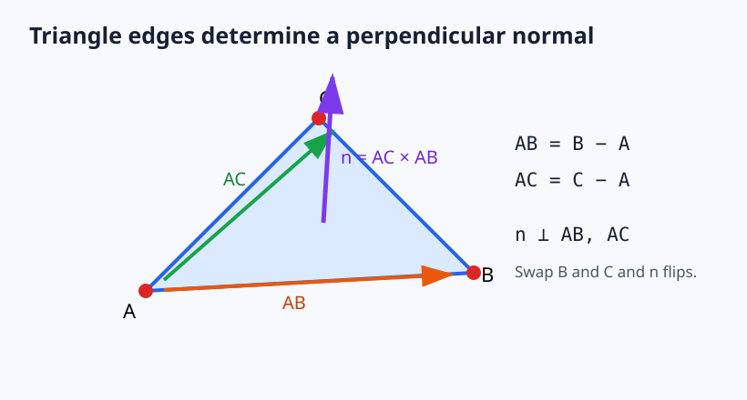

## 3. Rotation about the origin

To picture a 2D rotation, draw an arrow from the origin to the point. Turning that arrow does not change its length; it only changes which way it points. A counter-clockwise turn means the direction opposite clock hands. If the starting point is `(x,y)`, the turned point is `(x',y')`:

\[
x'=x\cos\theta-y\sin\theta,\qquad
y'=x\sin\theta+y\cos\theta.
\]

The arrow's length is called its radius $r$. Its direction can be described by angle $\phi$. A right triangle drops from the point to the X axis. The horizontal side is $x$ and the vertical side is $y$, so right-triangle ratios say $x=r\cos\phi$ and $y=r\sin\phi$. Cosine means “horizontal fraction”; sine means “vertical fraction.”

Here is how that picture gives the formula. Write the original point as $x=r\cos\phi$ and $y=r\sin\phi$. After a counter-clockwise turn by $\theta$, the same line has angle $\phi+\theta$; its length $r$ did not change. The new horizontal coordinate is $r\cos(\phi+\theta)$ and the new vertical coordinate is $r\sin(\phi+\theta)$. Splitting those angle sums into their horizontal and vertical parts gives:

\[
x'=r\cos(\phi+\theta)=r(\cos\phi\cos\theta-\sin\phi\sin\theta)=x\cos\theta-y\sin\theta,
\]
\[
y'=r\sin(\phi+\theta)=r(\sin\phi\cos\theta+\cos\phi\sin\theta)=y\cos\theta+x\sin\theta.
\]

The unit-circle picture shows why cosine is the horizontal component and sine is the vertical component. It also shows the rotated coordinate axes: the new X basis vector is $(\cos\theta,\sin\theta)$ and the new Y basis vector is $(-\sin\theta,\cos\theta)$.

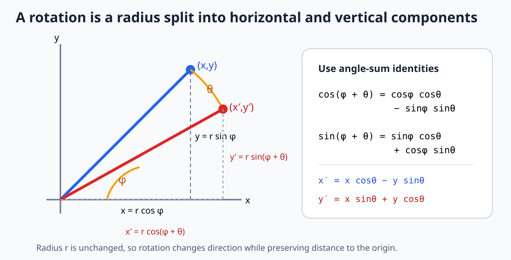

### From a 2D turn to a 3D turn

The key idea is to rotate a 3D point in a plane while leaving the axis perpendicular to that plane alone. For X rotation, imagine looking down the X axis. Every point's X coordinate is fixed, and its YZ pair moves on a circle. Apply the 2D rule with $y$ as the plane's horizontal coordinate and $z$ as its vertical coordinate. That gives the X equations in the code. Looking down Y gives the XZ equations; looking down Z gives the XY equations.

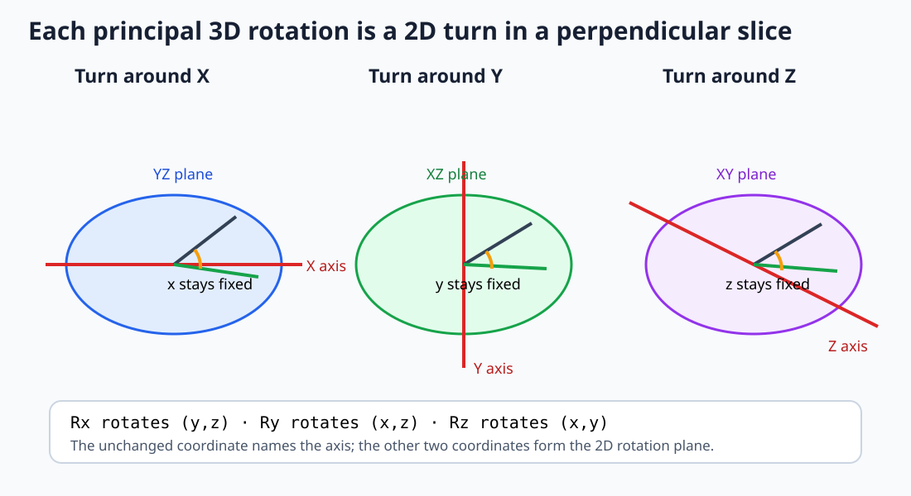

This is the relationship between 2D and 3D rotation: there is no separate mysterious 3D trigonometry. Each principal-axis rotation is a familiar 2D rotation applied to the two coordinates in that axis's perpendicular plane, while the axis coordinate remains fixed.

For example, `vect3RotateX((0,1,0), 0.01)` returns approximately `(0, 0.99995, 0.01000)`. The input points along Y. A tiny positive X turn moves a little of that Y value into Z. This is precisely what the two formulas in `vect3RotateX` say: X stays 0, the new Y is `cos(0.01)`, and the new Z is `sin(0.01)`. The renderer performs this small turn again on every update, which is why the model appears to rotate.

### Optional: the same rotation written as a matrix

A matrix is a rectangular table of numbers that multiplies a coordinate. To build the 2D rotation table, ask where the two one-unit arrows go. The X arrow starts at $(1,0)$; after rotation it is $(\cos\theta,\sin\theta)$. The Y arrow starts at $(0,1)$; after rotation it is $(-\sin\theta,\cos\theta)$. Those two results become the table's columns:

\[
R e_x=(\cos\theta,\sin\theta),\qquad R e_y=(-\sin\theta,\cos\theta).
\]

Multiplying the table by $(x,y)$ means: take $x$ copies of the turned X arrow and $y$ copies of the turned Y arrow, then add them. That gives exactly the same rotation formula:

\[
\begin{bmatrix}x'\\y'\end{bmatrix}=
\begin{bmatrix}\cos\theta&-\sin\theta\\\sin\theta&\cos\theta\end{bmatrix}
\begin{bmatrix}x\\y\end{bmatrix}.
\]

This gives one practical way to remember the table. Other libraries may lay the numbers out differently, so use the library's convention when you reach this optional step; the coordinate equations above remain the geometry to check against.

To rotate in 3D about one axis, the coordinate along that axis stays fixed and the other two coordinates use the 2D rule:

\[
R_x(\theta)\begin{bmatrix}x\\y\\z\end{bmatrix}=
\begin{bmatrix}x\\y\cos\theta-z\sin\theta\\y\sin\theta+z\cos\theta\end{bmatrix},
\]
\[
R_y(\theta)\begin{bmatrix}x\\y\\z\end{bmatrix}=
\begin{bmatrix}x\cos\theta+z\sin\theta\\y\\-x\sin\theta+z\cos\theta\end{bmatrix},\quad
R_z(\theta)\begin{bmatrix}x\\y\\z\end{bmatrix}=
\begin{bmatrix}x\cos\theta-y\sin\theta\\x\sin\theta+y\cos\theta\\z\end{bmatrix}.
\]

The update applies X, then Y, then Z to each original vertex. These operations are not generally interchangeable: in 3D, rotation order changes the final orientation. Each rotation here is about the model origin. For rotation around a pivot $q$, translate to the pivot, rotate, then translate back: $p'=q+R(p-q)$.

The order follows the actual statements in `update`: `RotateX`, then `RotateY`, then `RotateZ`. For column vectors that sequence is $p'=R_zR_yR_xp$ as one combined matrix, because the rightmost operation acts first. This apparent reversal is a common source of confusion. To rotate a point $(1,0,0)$ around Z by 90 degrees, the equations give $(0,1,0)$; the point stays one unit from the origin, which checks the invariant.

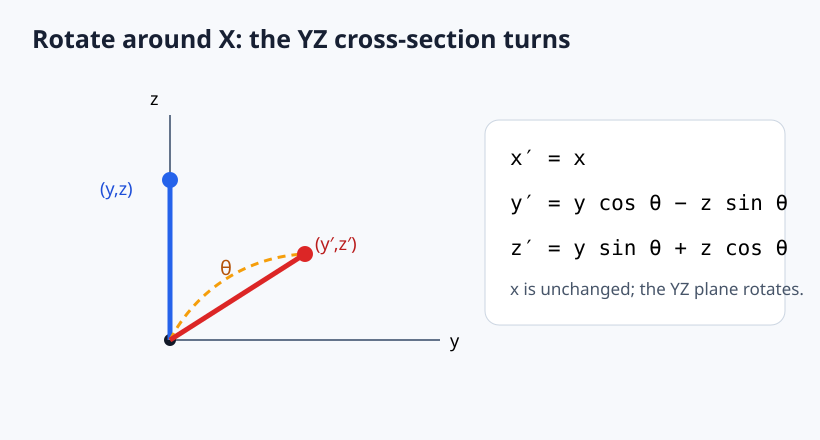

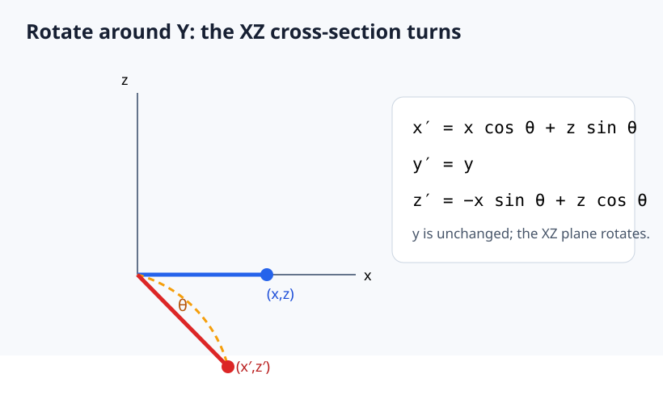

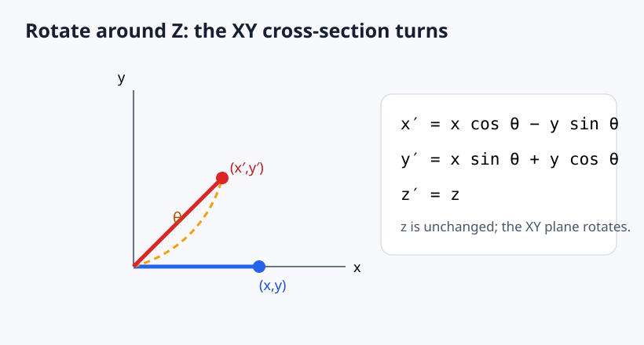

## 4. Mesh normalization and placement

`normalizeMesh()` in `src/main.c` first finds the smallest and largest X, Y, and Z values among the model's vertices. Those six numbers describe the smallest box, aligned with the X/Y/Z directions, that contains every vertex. To find the halfway point of the box on each axis, average that axis's minimum and maximum:

\[
c=\frac{min+max}{2}.
\]

The code subtracts this center $c$ from every vertex. Now the model's box is centered around `(0,0,0)`. It then measures each centered vertex's distance from the origin and keeps the greatest distance:

\[
r=\max_i\|v_i-c\|.
\]

Finally it divides every centered vertex by $r$. This makes the model fit inside a sphere of radius 1; the farthest vertex is exactly 1 unit away. Dividing every coordinate by the same number preserves the model's shape, but removes its original imported size. If all vertices were the same point, $r$ would be zero and the code skips this division.

After normalization and rotation, object placement adds the mesh position $t$: $p_w=Rp_o+t$. The current demo spaces models on X with $t_x=(i-(n-1)/2)2.6$, where $i$ is the model index and $n$ the number successfully loaded.

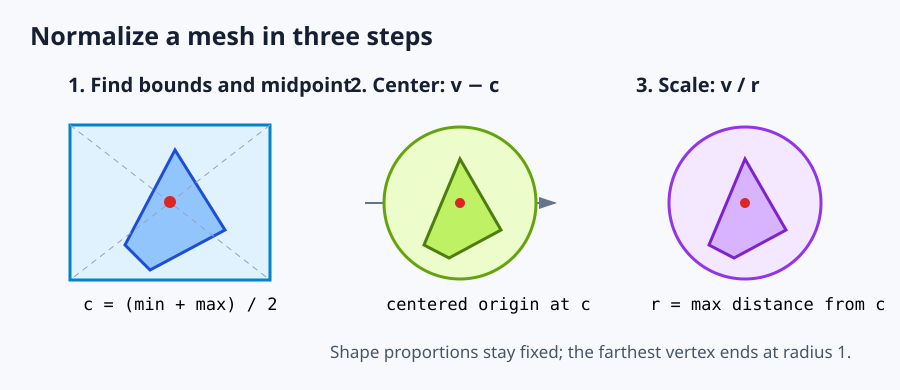

## 5. Camera-relative coordinates and perspective projection

The camera currently looks along positive Z without camera rotation. To express a world point relative to camera position $c$, subtract the camera position:

\[
p_c=p_w-c.
\]

Imagine a tiny camera hole, the point in the scene, and a flat screen between them. A straight line from the point through the hole reaches the screen. The point and its screen image make two right triangles that share the same corner angle, so they have the same shape. The large triangle has height $x$ and depth $z$; the smaller image triangle has height $x_s$ and depth $f$. Matching their width-to-depth ratios gives $x/z=x_s/f$. Solving for what lands on the image gives $x_s=fx/z$. The same picture applies vertically:

\[
x_s=f\frac{x}{z},\qquad y_s=f\frac{y}{z}.
\]

### Projection from a ray and a plane

The camera center (the pinhole) is the origin in camera space. A 3D point $P=(x,y,z)$ defines a ray from the camera: $R(t)=tP=(tx,ty,tz)$. Put an image plane at depth $f$. The ray meets that plane where its Z coordinate equals $f$, so $tz=f$ and therefore $t=f/z$. Substitute that one value into the ray:

\[
R(f/z)=\left(\frac{fx}{z},\frac{fy}{z},f\right).
\]

The plane's Z coordinate is fixed at $f$, so the image position is just its X and Y: $(fx/z,fy/z)$. This is the same similar-triangle result, expressed as a ray-plane intersection. The ray version generalizes naturally to off-center image planes, camera rotation, and ray casting.

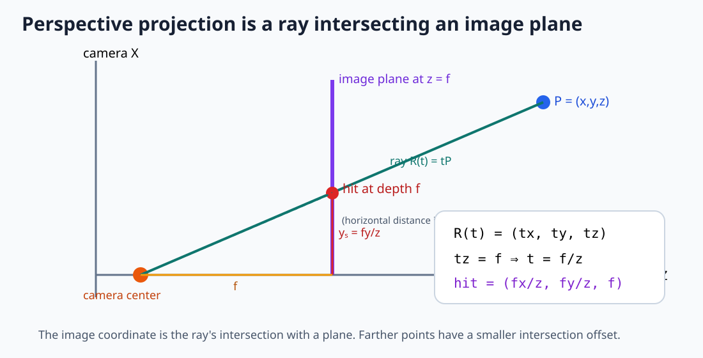

### What the perspective division means geometrically

For fixed X, doubling depth from $z$ to $2z$ halves the projected X offset. Points on one camera ray, such as $(1,1,2)$ and $(2,2,4)$, project to the same image coordinate because their coordinate ratios match. They differ in depth, though, so a depth buffer can still tell which one is nearer. A point near the camera expands away from the image center; a distant point contracts toward it.

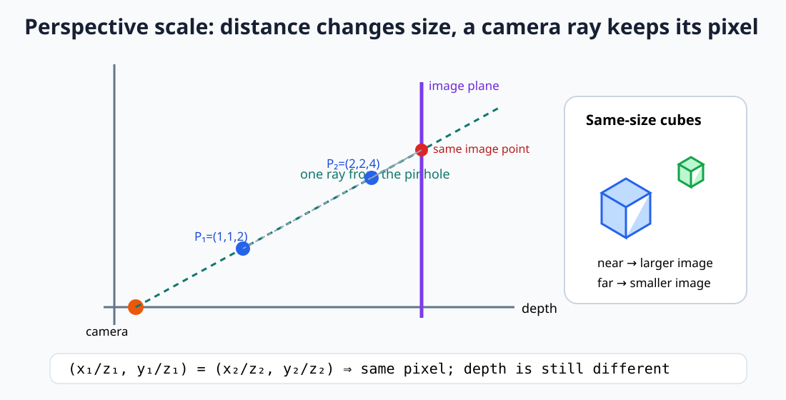

This projection discards depth from the 2D position. It is many-to-one: every point on a camera ray maps to the same image location. That is why the renderer must retain a depth value separately if it needs correct overlap, and why projection alone cannot determine which triangle is visible.

The source calls $f$ `fov` and sets it to 556; it acts as a focal-length scale in pixels, not a field-of-view angle. The projected offsets are shifted to the screen center:

\[
x_{pixel}=x_s+\frac{W}{2},\qquad
y_{pixel}=y_s+\frac{H}{2}.
\]

In pixel coordinates with Y increasing down the image, a common mapping is $y_{pixel}=H/2-y_s$; the current program uses plus. Which sign is correct depends on the direction you chose for world Y and the convention of your screen or image API. Likewise some camera systems look down negative Z, which changes the sign and the valid depth half-space. Pick a convention once, draw its axes, and apply it consistently.

### Field of view versus focal length

The code's `fov = 556` is a focal scale in pixels, despite the variable name. If a camera specification gives vertical field of view $\alpha$ and image height $H$, the image half-height is $H/2$. At the center, a right triangle has opposite side $H/2$ and adjacent side $f$, so:

\[
\tan(\alpha/2)=\frac{H/2}{f}\quad\Longrightarrow\quad f=\frac{H/2}{\tan(\alpha/2)}.
\]

This lets an implementation expose a field-of-view angle while still using the focal length in pixel projection. A wider field of view gives a smaller $f$ and stronger perspective distortion; a narrower view gives a larger $f$ and a more zoomed-in image.

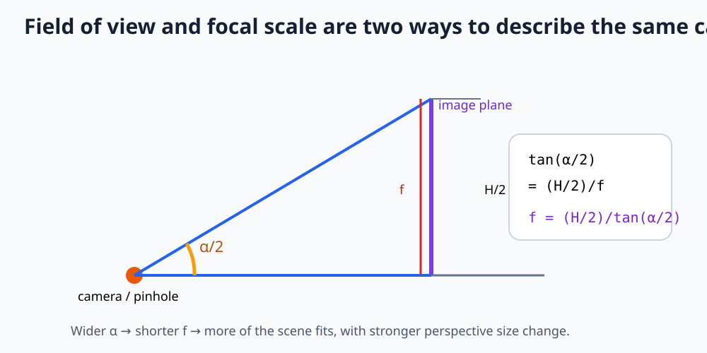

### Worked point from object space to pixel space

Here is a small numerical example using the renderer's actual camera, projection scale, and framebuffer size. Suppose a normalized model has a vertex at $p_o=(0,1,0)$ and is at the scene origin. `update()` turns it around X by 0.01 radians. The camera is at `(0,0,-7)`, `fov` is 556, and the framebuffer is 800 by 600.

For X rotation, X stays the same. With starting $x=0,y=1,z=0$:

\[
p_w=(0,\cos0.01,\sin0.01)\approx(0,0.99995,0.01000).
\]

Subtract the camera position to get camera coordinates:

\[
p_c=p_w-(0,0,-7)\approx(0,0.99995,7.01).
\]

Project and center in the viewport:

\[
x_s=556(0)/7.01=0,\qquad y_s=556(0.99995)/7.01\approx79.31,
\]
\[
(x_{pixel},y_{pixel})=(400+0,300+79.31)\approx(400,379.31).
\]

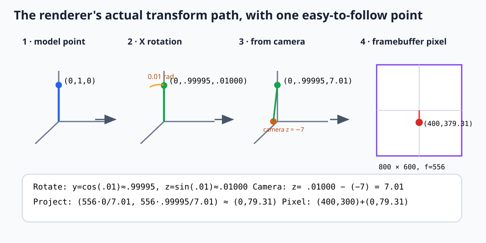

Check each stage: the X turn tipped this point slightly toward positive Z. Since the camera sits at Z = -7, that puts it about 7.01 units in front of the camera. It has no X offset, so it stays at the screen's center X of 400. Its positive Y offset projects downward in this program because `project()` adds the Y screen offset; its pixel Y is about 379. This is a worked example of the exact formulas the code uses, not a claim that this precise vertex is in an OBJ file.

Because screen Y usually grows downward while world Y grows upward, a production projection often negates the vertical term. This code does not. Points with $z=0$ divide by zero, negative Z points project behind the camera, and there is no near-plane clipping yet.

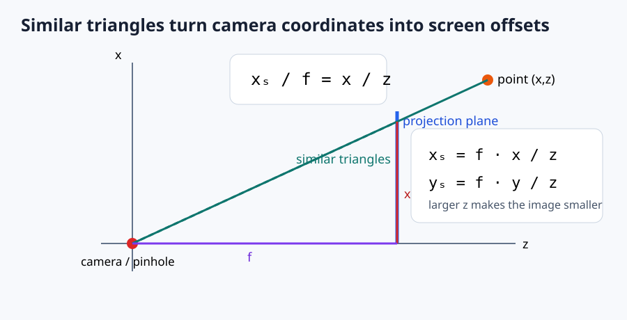

### Coordinate-space issue in current culling code

The transformed vertices have already had `cameraPosition` subtracted, so they are in camera-relative coordinates. The culling expression then computes `vector_A - cameraPosition` a second time. For a camera at `(0, 0, -7)`, this adds 7 to the Z difference again. For a fixed forward-facing camera, the ray from the camera origin to A should simply be `vector_A`; alternatively, compute the normal and ray in world space consistently. This mismatch can make visibility depend incorrectly on camera position and should be fixed in code separately.

## 6. Back-face culling

For a triangle, the code computes a unit normal $n$, then a vector $v$ from the camera to one vertex. It evaluates:

\[
d=n\cdot v.
\]

The sign indicates which side of the plane the ray points toward. With this project's `AC × AB` normal and current winding, faces for which $d<0$ are skipped. This is a winding-dependent convention; if the mesh winding or cross-product order changes, the condition may need to flip. Culling removes whole faces before projection, but it is not hidden-surface removal: overlapping front-facing triangles still draw in submission order because there is no depth buffer.

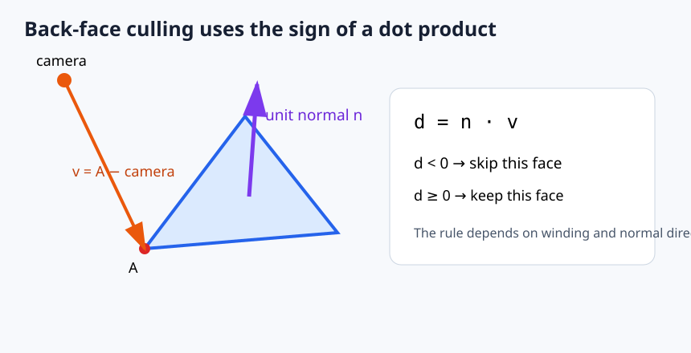

## 7. Line rasterization and framebuffer addressing

The line drawer uses a DDA-style step. For endpoints $(x_1,y_1)$, $(x_2,y_2)$, define:

\[
\Delta x=x_2-x_1,\quad \Delta y=y_2-y_1,\quad
N=\max(|\Delta x|,|\Delta y|).
\]

For $N>0$, each step advances by:

\[
\delta x=\frac{\Delta x}{N},\qquad
\delta y=\frac{\Delta y}{N}.
\]

Starting at the first endpoint, add these increments $N$ times and convert each floating coordinate to an integer pixel. The exact second endpoint is written afterward to avoid accumulated floating-point error. The $N=0$ special case writes the single shared endpoint. `setPixel` clips coordinates to the framebuffer bounds.

For row-major pixels of width $W$, the linear index is:

\[
index=yW+x.
\]

This follows because each completed row contributes $W$ pixels, then $x$ advances within the current row. `clearColorBuffer` visits every $(x,y)$; `setPixel` checks $0\le x<W$ and $0\le y<H$ before indexing.

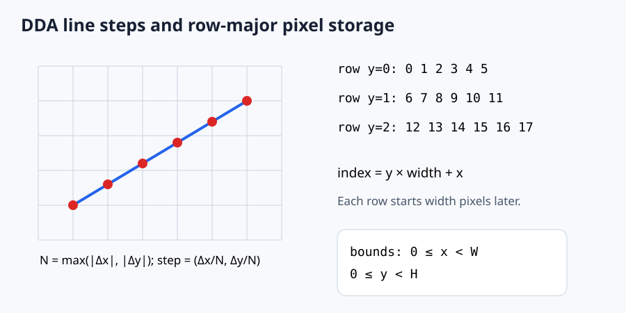

Triangles in the current renderer are wireframes: the three edges are sent to this line routine. The filled-triangle edge equations and barycentric interpolation are not present in the code.

## 8. Dynamic-array storage and frame pacing

The stretchy array stores two integers immediately before its elements: capacity $C$ and occupied length $L$. Appending $k$ elements requires $L+k$ slots. If that exceeds capacity, the new capacity is:

\[
C'=\max(L+k,2C).
\]

This geometric growth makes repeated appends amortized $O(1)$, although one append can move the entire allocation. The code's `array_hold` records the new occupied count before the caller fills the appended slot. Allocation failure is not checked, so the current implementation can dereference a null allocation on memory exhaustion.

The frame target is integer milliseconds $T=1000/FPS$. With `FPS = 60`, integer division gives $T=16$ ms (about 62.5 target iterations per second before other work). If a frame has taken less than $T$, the loop delays for $T-frameTime$. Rotation currently advances by a fixed angle per update, so its speed changes with actual frame rate; time-based rotation would use $\theta_{new}=\theta_{old}+\omega\Delta t$.

## 9. Formula inventory and implementation map

| Topic | Formula | Code |
|---|---|---|
| Vector length | $\sqrt{\sum x_i^2}$ | `vect2_length`, `vect3_length` |
| Vector arithmetic | component-wise (+,-,\times s,/s) | `src/vector.c` |
| Normalize | $v/\|v\|$ | `vect2_normalize`, `vect3_normalize` |
| Dot product | $\sum a_ib_i$ | `vect2_dot`, `vect3_dot` |
| Cross product | determinant expansion | `vect3_cross` |
| Axis rotations | sine/cosine rotation equations | `vect3RotateX/Y/Z` |
| Bounding-box center | $(min+max)/2$ | `normalizeMesh` |
| Unit-radius scale | $v/r, r=max_i\|v_i\|$ | `normalizeMesh` |
| Object/camera transforms | rotate, translate, subtract camera | `update` |
| Perspective | $(fx/z,fy/z)$ | `project` |
| Screen center | $(W/2,H/2)$ offset | `update` |
| Face culling | $n\cdot v$ sign | `update` |
| DDA line | $N=max(|dx|,|dy|)$, increments $d/N$ | `drawLine` |
| Pixel address | $yW+x$ | `setPixel` |
| Dynamic array growth | $max(L+k,2C)$ | `array_hold` |
| Frame cap | $1000/FPS$ ms | `update` |

## 10. Turning the geometry into an implementation

### Name the spaces in your data flow

Even if every vertex is a three-number array, name intermediate variables by space: `objectPoint`, `worldPoint`, `cameraPoint`, `projectedPoint`, `pixelPoint`. Treat each arrow as an equation with a clear input and output:

\[
p_w=R p_o+t,\qquad p_c=V p_w,\qquad p_s=\left(f_x\frac{x_c}{z_c},f_y\frac{y_c}{z_c}\right),\qquad p_{pixel}=viewport(p_s).
\]

Here $V$ is the view transform. With a camera that only translates, $V p_w=p_w-c$. With a rotated camera, the view transform also expresses the displacement in the camera's right/up/forward basis. Never subtract the camera position twice, or mix a world-space normal with a camera-space ray.

### If your camera can turn: use its three direction arrows

The camera in this project does not turn. If you later add camera rotation, imagine attaching three perpendicular arrows to the camera: `right`, `up`, and `forward` (the direction it looks). Given world point $p$ and camera position $c$, first make the arrow $d=p-c$ from the camera to the point. Dotting $d$ with each camera arrow measures how far the point is right, up, and forward:

\[
x_c=d\cdot right,\qquad y_c=d\cdot up,\qquad z_c=d\cdot forward.
\]

For the camera used now, `right=(1,0,0)`, `up=(0,1,0)`, and `forward=(0,0,1)`, so these dot products simply return the X, Y, and Z values after subtracting camera position. For a turning camera, the arrows turn too. They must stay perpendicular and length one. If the chosen `up` arrow points exactly along `forward`, there is no unique `right` direction; choose a different up arrow.

### Optional advanced topic: combine transforms with matrices

You can skip this section and still understand the renderer above. A matrix is a table of numbers used to apply several coordinate operations together. To let one table handle both turning and moving, graphics math temporarily writes a point with a fourth number: $(x,y,z,1)$. A direction that should not move gets $(x,y,z,0)$. That last number is bookkeeping: translation multiplies it, so a point moves and a direction does not. In the column-vector layout used by this example, object placement is:

\[
\begin{bmatrix}x_w\\y_w\\z_w\\1\end{bmatrix}=
\begin{bmatrix}R_{11}&R_{12}&R_{13}&t_x\\R_{21}&R_{22}&R_{23}&t_y\\R_{31}&R_{32}&R_{33}&t_z\\0&0&0&1\end{bmatrix}
\begin{bmatrix}x_o\\y_o\\z_o\\1\end{bmatrix}.
\]

The upper-left 3-by-3 part is the turn; the last column is the move. This table expresses the same operation as `rotate point, then add position`. If a view table $V$ changes world coordinates into camera coordinates and a model table $M$ turns and places the object, then $p_c=VMp_o$. The rightmost table acts first. In this project, the code does the operations separately, which makes their order easier to see.

Graphics APIs often delay the division in perspective projection. They store X and Y multiplied by the focal scale, and store depth in a special fourth coordinate called `w`. The API divides by `w` afterward. It also maps depth into another value for depth testing. Different APIs use different depth ranges, so use their documentation when adding that stage; the basic picture remains the ray and image plane explained above.

### Minimal renderer algorithm

For each vertex:

1. Start with its object-space position.
2. Rotate around the intended object pivot.
3. Add the object/world translation.
4. Transform world coordinates into camera coordinates.
5. Reject or trim points too close to or behind the camera before dividing by depth. This is called clipping: remove the part that lies outside the usable camera region.
6. Divide by camera depth to get image-plane coordinates.
7. Scale and offset into pixel coordinates, accounting for the image's Y direction.

For each triangle, apply the same vertex path to all three corners. Use the transformed corners for face orientation and projected corners for drawing. A filled renderer then visits pixels inside the projected triangle, interpolates depth, and keeps the nearest sample in a depth buffer. Clipping must occur before perspective division because an edge that crosses the camera plane can otherwise produce enormous or inverted coordinates.

### Geometric checks that travel across languages

- **Rotation length:** before and after rotation, compare $x^2+y^2+z^2$. It should stay the same within floating point tolerance.
- **Rotation inverse:** rotate by $\theta$ and then by $-\theta$. The point should return to its start (for the same axis and order).
- **Translation edge:** translate both triangle endpoints equally. Their difference must remain unchanged.
- **Camera at origin:** camera-relative position should equal world position when $c=(0,0,0)$ and camera orientation is identity.
- **Perspective scale:** double both $x$ and $z$; $x_s=fx/z$ should not change.
- **Depth direction:** with positive-Z-forward, points with $z_c\le0$ should not be projected as visible front points.
- **Viewport center:** camera-forward points $(0,0,z)$ should land at the chosen image center.
- **Winding:** swap two triangle corners. The normal should reverse and a culling test should change its result.
- **Index bounds:** every pixel write must verify its coordinates before converting to a linear index.

These checks test the meaning of the math, not a specific language, compiler, GPU, or graphics library.

## 11. Common convention failures and how to diagnose them

| Symptom | Likely cause | Geometry check |
|---|---|---|
| Object rotates in an unexpected direction | Angle sign, handedness, or axis orientation differs | Rotate $(1,0)$ by $90^\circ$ and draw positive axes |
| Camera movement makes the scene move the same way | Camera translation was added instead of subtracted in the view transform | Set camera at origin, then move it +X; static world points should shift left in camera space |
| Model disappears when culling is enabled | Cross-product order, face winding, or dot sign disagrees | Draw normal arrows and log $n\cdot v$ for one known front face |
| Object gets larger when farther away | Projection uses $z/x$ instead of $x/z$, or camera forward sign is inconsistent | Compare points on one ray at depths $z$ and $2z$ |
| Top of scene appears at the bottom | World Y and pixel Y have opposite directions | Test the point $(0,+1,z)$ and choose whether pixel Y adds or subtracts |
| Huge coordinates or NaNs near camera | Dividing before clipping, or zero/near-zero depth | Reject depths below a positive near threshold before projection |
| Rotation changes object size | Formula is not an orthonormal rotation, angle units are wrong, or scale is mixed in | Check squared length and verify the trig functions receive radians |

Debug one point and one triangle at a time. Print or visualize the coordinates after each space change. If the object-space and world-space values are right but the camera-space values are wrong, projection is not the place to patch the symptom.

### Not implemented yet

The README roadmap mentions clipping, depth buffering, filled triangle rasterization, lighting, and texture mapping. Their equations are not included as formulas used by this course implementation because the code does not implement those stages yet. Once those features land, this guide should add their derivations alongside the implementation.
